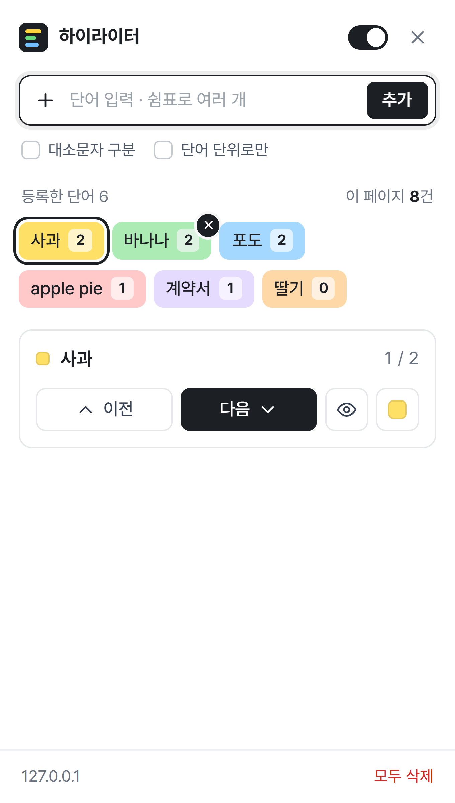

# 멀티 단어 하이라이터

웹페이지에서 여러 단어를 색깔별로 동시에 표시하는 크롬 확장프로그램입니다.

## 기능

- 여러 단어를 쉼표로 한 번에 등록하고, 단어마다 다른 색으로 표시
- 단어별 개수 표시, 이전/다음 위치로 이동
- 단어별 켜기/끄기, 색 변경, 전체 켜기/끄기
- 사이드 패널 또는 팝업 중 선택 (패널 위 버튼이나 아이콘 우클릭 메뉴)
- 대소문자 구분, 단어 단위 검색 옵션

정확도와 동작 방식:

- 페이지 내용(DOM)을 바꾸지 않고 [CSS Custom Highlight API](https://developer.mozilla.org/docs/Web/API/CSS_Custom_Highlight_API)로 표시하므로 사이트 동작을 방해하지 않습니다.
- `사<b>과</b>`처럼 태그로 나뉜 단어, `&nbsp;`나 줄바꿈이 낀 구절도 찾습니다.
- 화면에 보이는 것만 셉니다 (접힌 메뉴, 숨겨진 영역은 "숨김"으로 따로 표시).
- 나중에 추가되는 내용, 편집 영역, 웹 컴포넌트(Shadow DOM), iframe 안의 글자까지 포함합니다.

## 설치

1. [Releases](../../releases)에서 zip을 내려받아 압축을 풉니다. (또는 이 저장소를 클론)
2. `chrome://extensions`를 열고 오른쪽 위 **개발자 모드**를 켭니다.
3. **압축해제된 확장 프로그램을 로드합니다**를 눌러 `manifest.json`이 있는 폴더를 선택합니다.
4. 이미 열려 있던 페이지는 새로고침(F5)합니다.

크롬 121 이상 (Edge도 동작).

## 개인정보

- 등록한 단어는 브라우저의 `chrome.storage.local`에만 저장되며 어디로도 전송되지 않습니다.
- 권한: `storage`(단어 저장), `sidePanel`(사이드 패널), `contextMenus`(아이콘 우클릭 메뉴), 모든 사이트의 콘텐츠 스크립트(페이지에 표시하기 위해).
- 한계: 하이라이트 API의 특성상, 화면에 표시된 단어는 그 페이지의 스크립트가 읽을 수 있습니다. 숨겨진 위치에는 칠하지 않으므로 숨긴 미끼 텍스트로 단어 목록을 알아내는 것은 막혀 있습니다.

## 구조

| 파일 | 역할 |
|---|---|
| `manifest.json` | 확장프로그램 설정 (Manifest V3) |
| `content.js` | 페이지에서 단어를 찾아 표시, 개수 집계, 이동, iframe/Shadow DOM 처리 |
| `panel.html` / `panel.css` / `panel.js` | 사이드 패널과 팝업 화면 (같은 페이지, `?view=popup`) |
| `background.js` | 팝업/사이드 패널 전환, 우클릭 메뉴, 프레임 간 메시지 중계 |
| `fonts/` | Pretendard 폰트 ([SIL OFL 1.1](fonts/LICENSE.txt)) |
| `design/` | UI 시안과 스크린샷 (배포 zip에는 포함하지 않음) |

## 알려진 한계

- 입력창(input/textarea) 안의 글자, 캔버스로 그리는 문서(구글 문서 등), PDF, 이미지 속 글자는 표시할 수 없습니다.
- "단어 단위로만" 옵션은 영어용입니다. 한국어는 "사과를"처럼 조사가 붙은 단어를 찾지 않으므로 끄고 쓰는 것을 권장합니다.
- 확장프로그램을 새로고침/업데이트하면 열려 있던 페이지는 새로고침해야 다시 표시됩니다.
